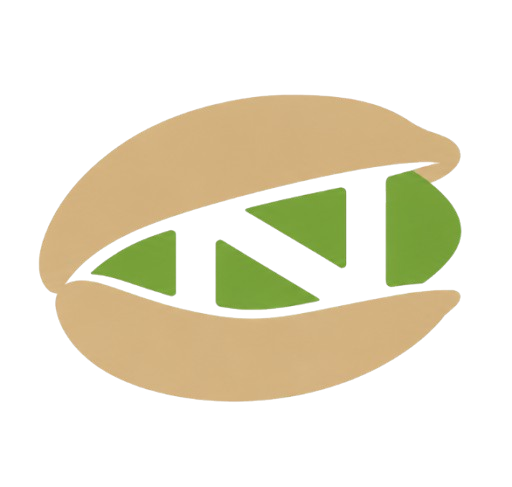

<p align="center">
  
</p>

<h1 align="center">NEXTHON</h1>

<p align="center">
  <strong>A general-purpose programming language built from scratch in Python.</strong>
</p>
<p align="center">
  <a href="https://github.com/Nexform-star/NEXTHON">
    
  </a>
  <a href="https://github.com/Nexform-star/NEXTHON/blob/main/LICENSE">
    
  </a>
    <a href="https://marketplace.visualstudio.com/items?itemName=nexform.nexthon-language">
      
    </a>
    <a href="https://marketplace.visualstudio.com/items?itemName=nexform.nexthon-language">
      
    </a>
</p>

<p align="center">
  <a href="https://github.com/Nexform-star/NEXTHON">Main Repository</a> •
  <a href="https://github.com/Nexform-star/NEXTHON-Community">Community</a> •
  <a href="https://marketplace.visualstudio.com/items?itemName=nexform.nexthon-language">VS Code Extension</a> •
  <a href="docs/README.md">Documentation</a>
</p>

---

## About

NEXTHON is an experimental general-purpose programming language developed from scratch in Python.

The project explores the fundamentals of programming language design, including lexical analysis, parsing, abstract syntax trees (ASTs), and interpretation.

Its goal is to provide a readable syntax while building a language with its own features and execution environment.

NEXTHON is an independent project and is continuously evolving.

## Screenshots

### Code Editor


### Program Execution


### Project Structure


## Features

- Variables and constants
- Arithmetic, comparison and logical expressions
- Conditional statements (`if`, `elif`, `else`)
- Loops (`while`, `for`)
- Functions, parameters and return values
- Recursive functions
- Lists, tuples, dictionaries and sets
- Built-in functions and string methods
- Module imports
- Exception handling (`try`, `except`, `finally`)
- File operations
- Interactive REPL

## Getting Started

### Requirements

- Python 3.14+
- Windows
- Git
- Visual Studio Code (optional)

### Clone the repository

```bash
git clone https://github.com/Nexform-star/NEXTHON.git
cd NEXTHON
```

### Run a NEXTHON program

From the project directory:

```powershell
.\nexthon.cmd examples\hello.ne
```

You can also use the launcher globally if the directory containing `nexthon.cmd` is added to your PATH:

```powershell
nexthon examples\hello.ne
```

### Run the interpreter directly

```powershell
$env:PYTHONPATH = "src"
py -m nexthon.interpreter examples\hello.ne
```

## Example

```ne
var score = 17
var number = 12

print("Addition:")
print(score + number)

print("Multiplication:")
print(score * number)

function greet(name) {
    print("Hello, " + name)
}

greet("NEXTHON")
```

## VS Code Extension

NEXTHON source files use the `.ne` extension.

The official VS Code extension provides:

- Syntax highlighting
- Language recognition for `.ne` files
- Code snippets
- Basic language configuration

<p align="center">
  <a href="https://marketplace.visualstudio.com/items?itemName=nexform.nexthon-language">
    
  </a>
  <a href="https://github.com/Nexform-star/NEXTHON/tree/main/vscode-extension">
    
  </a>
</p>

### Install manually

You can install the extension from the Marketplace or manually using the packaged `.vsix` file.

```powershell
code --install-extension .\vscode-extension\nexthon-language-0.1.0.vsix
```

## Community & Contributions

Want to learn, experiment, or contribute to NEXTHON?

The **NEXTHON Community** repository is a place where developers can practice programming, share examples, propose tutorials, solve challenges, and contribute projects written in NEXTHON.

Whether you're a beginner or an experienced developer, contributions are welcome.

**What you can contribute:**

- Beginner-friendly examples
- Code samples
- Tutorials and guides
- Programming challenges
- Small projects
- Documentation improvements

All contributions are reviewed before being merged.

<p align="center">
  <a href="https://github.com/Nexform-star/NEXTHON-Community">
    
  </a>
</p>

See the [Community Repository](https://github.com/Nexform-star/NEXTHON-Community) to get started.

## Documentation

The documentation covers installation, syntax, variables, data types, operators, conditions, loops, functions, collections, modules, exceptions, built-in functions, and file handling.

**[Read the documentation](docs/README.md)**

## Project Structure

```text
NEXTHON/
├── .vscode/
├── assets/
├── docs/
├── examples/
├── src/
│   └── nexthon/
│       ├── __init__.py
│       ├── ast.py
│       ├── errors.py
│       ├── interpreter.py
│       ├── lexer.py
│       ├── parser.py
│       └── tokens.py
├── vscode-extension/
├── .gitignore
├── LICENSE
├── README.md
└── nexthon.cmd
```

## Development

NEXTHON is an ongoing experimental project.

New features, improvements, bug fixes, and documentation updates are developed over time.

The language may evolve, and some features or syntax may change between versions.

## License

NEXTHON is distributed under the MIT License.

See the [LICENSE](LICENSE) file for details.

---

<p align="center">
  Created and maintained by <a href="https://github.com/Nexform-star">Nexform-star</a>
</p>

<p align="center">
  <sub>Built with Python. Developed with curiosity.</sub>
</p>
