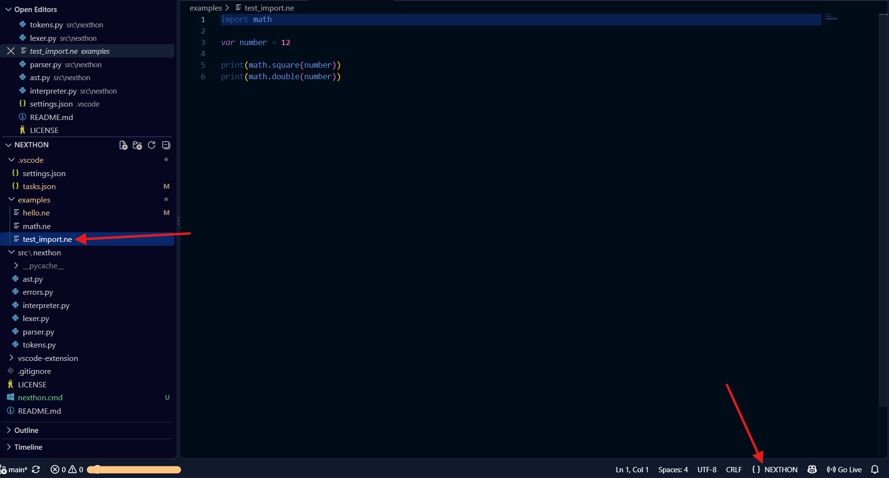
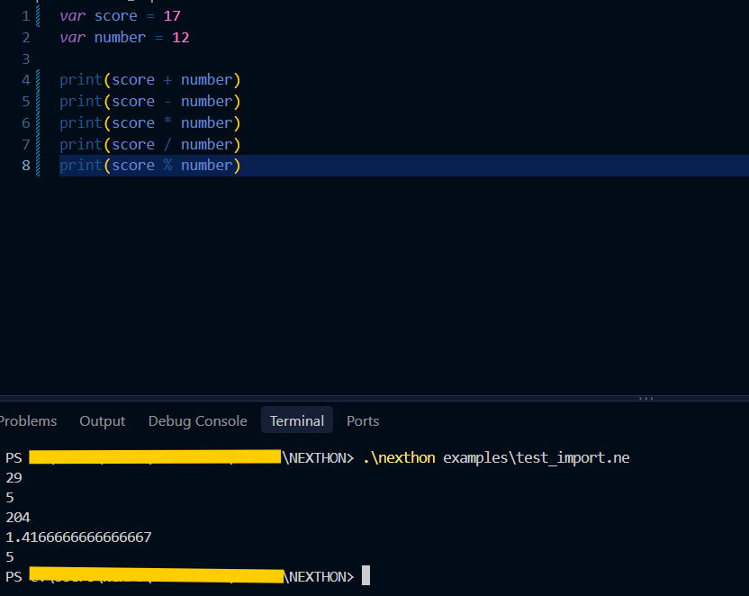
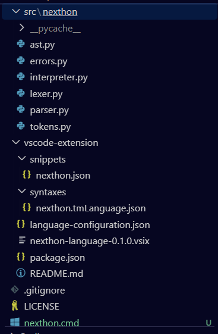

# NEXTHON

**A general-purpose programming language built from scratch in Python.**

NEXTHON is an experimental programming language designed to provide a simple and readable syntax while exploring the fundamentals of language design, including lexers, parsers, abstract syntax trees and interpreters.

## Screenshots

### Code Editor



### Program Execution



### Project Structure



## Features

- Variables and constants
- Arithmetic and logical expressions
- Conditional statements (`if`, `elif`, `else`)
- Loops (`while`, `for`)
- Functions, parameters and return values
- Recursion
- Lists, tuples and dictionaries
- Built-in functions and string methods
- Module imports
- Exception handling (`try`, `except`, `finally`)
- File operations
- Interactive REPL

## Project Structure

```text
NEXTHON/
├── .vscode/
│   ├── settings.json
│   └── tasks.json
├── assets/
│   ├── nexthon-code.png
│   ├── nexthon-execution.png
│   └── nexthon-project-structure.png
├── examples/
│   ├── hello.ne
│   ├── math.ne
│   └── test_import.ne
├── src/
│   └── nexthon/
│       ├── __init__.py
│       ├── ast.py
│       ├── errors.py
│       ├── interpreter.py
│       ├── lexer.py
│       ├── parser.py
│       └── tokens.py
├── vscode-extension/
│   ├── language-configuration.json
│   ├── package.json
│   ├── snippets/
│   ├── syntaxes/
│   └── nexthon-language-0.1.0.vsix
├── .gitignore
├── LICENSE
├── README.md
└── nexthon.cmd
```

## Getting Started

### Requirements

- Python 3
- Windows
- Visual Studio Code (optional)

### Clone the repository

```bash
git clone https://github.com/Nexform-star/NEXTHON.git
cd NEXTHON
```

### Run a NEXTHON program

From the project directory, run:

```powershell
.\nexthon.cmd examples\hello.ne
```

You can also use the launcher globally if its directory is available in your PATH:

```powershell
nexthon examples\hello.ne
```

### Run the interpreter directly

```powershell
$env:PYTHONPATH = "src"
py -m nexthon.interpreter examples\hello.ne
```

## Example

```ne
var score = 17
var number = 12

print("Addition:")
print(score + number)

print("Multiplication:")
print(score * number)

function greet(name) {
    print("Hello, " + name)
}

greet("NEXTHON")
```

## VS Code Support

NEXTHON source files use the `.ne` extension.

The repository includes a VS Code workspace configuration and a task for running the currently active NEXTHON file with `Ctrl + Shift + B`.

A separate language extension provides:

- Syntax highlighting
- Language recognition for `.ne` files
- Code snippets
- Basic language configuration

### Install the VS Code extension

Open a terminal in the `vscode-extension` directory and run:

```powershell
code --install-extension .\nexthon-language-0.1.0.vsix --force
```

## Development

NEXTHON is an ongoing learning and development project.

The language is experimental, and its syntax and features may evolve over time.

## License

This project is licensed under the MIT License. See [LICENSE](LICENSE) for details.

---

**Created by [Nexform-star](https://github.com/Nexform-star)**
